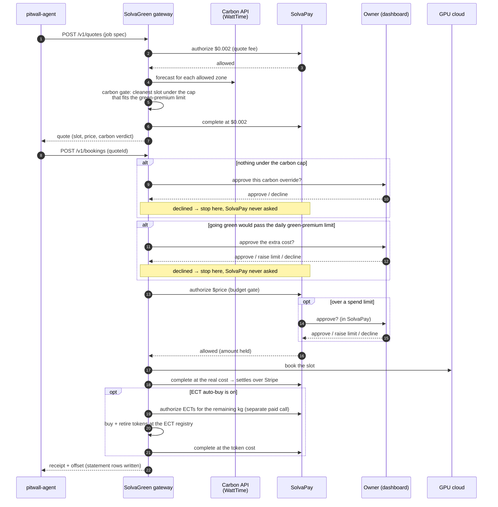

# SolvaGreen architecture

**Audience:** the team building SolvaGreen and the people judging it. You don't need to read any code to follow this.

**Demo setting:** McLaren Racing at the 2026 Las Vegas Grand Prix. The user is Will Joseph (race engineer to Lando Norris), named for illustration only.

## The decision in one paragraph

SolvaGreen is a **gateway that sits between an AI agent and the services it pays for**. It adds a carbon check on top of SolvaPay's spending controls without copying them. **SolvaPay stays the single source of truth for money**: spend limits, owner approvals, holds and settlement all run in SolvaPay, through its official agent-payments SDK (`@solvapay/agents`). **SolvaGreen owns carbon**: it buys grid forecasts, picks the cleanest region and hour within the owner's daily **green-premium limit**, asks the owner when nothing fits, and auto-buys **ECTs** (Emission Carbon Tokens, 1 ECT = 1 kgCO₂e) to offset what each job still emits. Both SolvaGreen checks (carbon and green premium) run **before** SolvaPay is asked to authorize anything. A job the owner turns down on those grounds never holds money and never triggers a second, budget approval.

## How a job flows

## The parts

| Part | File(s) | What it does |
|---|---|---|
| **Agent API** | [src/http/agentApi.ts](../src/http/agentApi.ts) | What agents call: `/v1/quotes` and `/v1/bookings`. Both are paid through SolvaPay's HTTP gate. |
| **Carbon + green-premium gate** | [src/domain/planner.ts](../src/domain/planner.ts) | Pure logic: list every zone × hour slot, then pick the lowest-emission one that is under the carbon cap **and** fits the green-premium limit (extra GPU cost vs the cheapest option + ECT cost). No I/O, so easy to test. |
| **Request generator** | [src/domain/jobGenerator.ts](../src/domain/jobGenerator.ts) | Generates varied race-weekend requests for McLaren from 12 templates (overnight aero CFD, wind-tunnel correlation, parts sign-off before the factory builds them, live strategy for upcoming sessions, Monte Carlo strategy sims, tyre models, telemetry, setup sweeps, driver-in-the-loop prep, reliability, fan-app media). Each has realistic ranges for GPU-hours and deadline, and is spread across grids or pinned to the trackside region. Seeded, so demos repeat exactly after a Reset. |
| **ECT registry** | [src/services/ectRegistry.ts](../src/services/ectRegistry.ts) | Mock token registry: sells Emission Carbon Tokens with serial numbers and retires them on purchase, so they can't be counted twice. |
| **Carbon providers** | [src/carbon/provider.ts](../src/carbon/provider.ts) | WattTime (the Las Vegas scenario; Electricity Maps is also supported for future EU races) or mock data, behind one interface. Each switches on automatically when its API key is set. |
| **SolvaPay wiring** | [src/payments/solvapay.ts](../src/payments/solvapay.ts) | The only file that knows the mode. Builds the SDK pieces: agent verification, authorize and complete. |
| **SolvaPay stand-in** | [src/payments/sandboxSpendPolicy.ts](../src/payments/sandboxSpendPolicy.ts) | Demo mode only. Implements the SDK's own client interface, so the gateway can't tell it from the real SolvaPay. |
| **Approvals** | [src/services/approvals.ts](../src/services/approvals.ts) | Holds requests until the owner decides. Carbon and green-premium approvals are always ours; budget approvals only in demo mode. |
| **Store + audit log** | [src/services/store.ts](../src/services/store.ts) | Quotes, the statement, job outcomes, ECT lots and the green-premium total. Every statement row is appended to `data/ledger.ndjson`. |
| **Dashboard API** | [src/http/dashboardApi.ts](../src/http/dashboardApi.ts) | The owner's side: state snapshot, live events (SSE), decisions, policy edits. |
| **Dashboard** | [public/](../public/) | Six pages (Overview, Spend policies, Job queue, Call log, Statement, Carbon tokens) sharing [app.js](../public/app.js), which owns the nav, the live connection and the approval pop-up. Views only: no business logic in the browser. |
| **Demo agent** | [src/demo/demoAgent.ts](../src/demo/demoAgent.ts) | An HTTP client like any external agent. Delete it and the gateway still works. |

## Two modes, one codebase

| | **Demo** (default) | **Sandbox** |
|---|---|---|
| Turned on by | nothing set | `SOLVAPAY_SECRET_KEY=sk_sandbox_…` |
| Budget limits and approvals | local stand-in, editable on our dashboard | real SolvaPay; the owner approves in SolvaPay |
| Agent identity | tokens signed with a throwaway local key (the SDK's test helpers) | SolvaPay-issued tokens or `agk_…` agent keys |
| Money | none | SolvaPay test money |
| Carbon data | mock curves unless API keys are set | same |

The gateway's own code is the same in both modes. Only [src/payments/solvapay.ts](../src/payments/solvapay.ts) branches.

## Why it's built this way

1. **SolvaPay owns the money rules; we don't copy them.** An earlier version checked budgets in the browser. Two copies of the spend limits would drift apart, and the agent could skip ours. Now the limits live only in SolvaPay.
2. **SolvaGreen's gates before budget.** If the owner declines on carbon or on the cost of going green, nothing is held and there's no second approval. Tests enforce both.
3. **Quote, then book.** The agent can only book a quote the gateway issued itself, for its own account, within 15 minutes, and only once. It can't invent a cheaper slot or reuse someone else's quote.
4. **Idempotency.** Every paid call carries an `Idempotency-Key`. SolvaPay keys the call on it, so a network retry continues the same call instead of paying twice.
5. **Fail closed.** If the carbon API, the cloud or SolvaPay is unreachable, the hold is released and nothing is charged.
6. **The statement is a by-product.** Each payment writes its statement row (merchant, grid reading, emissions, SolvaPay call reference) at the moment it happens, and appends it to `data/ledger.ndjson`. The CSV export is the hand-off to CSRD or ESG reporting.
7. **The green-premium limit steers before it blocks.** The planner first looks for a clean slot that fits the remaining limit (e.g. Pacific NW hydro instead of pricier California solar), and only asks the owner when no clean slot fits.
8. **ECTs are a separate paid call.** Offsetting never blocks or undoes a booking: if SolvaPay refuses the ECT purchase or the registry is down, the job stays booked and the gap shows as less than 100% coverage.

## Constraints to know before the pitch

- **SolvaPay agent payments are in preview** (SDK `@solvapay/agents` 0.1.1, released 16 Nov 2026). SolvaPay has to enable them on our merchant account. Until then, sandbox mode gets `feature_not_enabled` and every paid call is refused as `unavailable`. **Live (real-money) agent payments aren't open yet.**
- **USD only.** SolvaPay settles agent payments in USD credits, which suits the Las Vegas scenario. A European race would need a currency display layer.
- **Carbon approvals live on our dashboard; budget approvals live in SolvaPay.** In sandbox mode the owner may get two prompts in two places for one job that breaks both caps. That's acceptable for the demo. A real product would ask SolvaPay for a policy hook so there's one approval inbox.
- **The dashboard has no login.** It binds to localhost only. Approving a payment is the owner's authority, so it needs owner sign-in before it's exposed anywhere.
- **In-memory state.** A restart clears quotes and approvals; the audit file survives. Production needs Postgres, keyed by the SolvaPay principal (`ppl_…`).
- **ECTs are mocked.** The registry, serial numbers and price ($0.045 per kg) are made up. A real "carbon-neutral" claim needs credits from a verified registry (e.g. Verra, Gold Standard), and offsets are viewed as weaker than actually cutting emissions, so lead the pitch with the shifting and present offsets as covering the remainder.
- **The purpose check is a stand-in.** In demo mode a keyword rule catches the injected request (J5). Real SolvaPay uses its own classifier over the prompt facts we send.

## Next steps, in order

1. Ask SolvaPay to enable agent payments on our sandbox account, then run in sandbox mode with a real sandbox agent.
2. Add WattTime trial keys (Nevada is region NEVP), so the charts and decisions use live grid data.
3. Expose the same two tools over MCP (`createAgentMcpRoute` from `@solvapay/agents/mcp`), so Claude, ChatGPT or Cursor can use SolvaGreen directly.
4. Owner sign-in on the dashboard, and Postgres for state.
